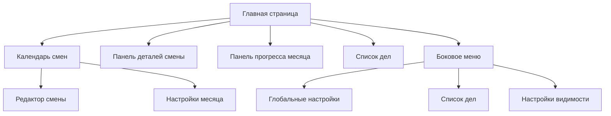

# График Смен (Shift Schedule)

**Версия:** 1.0.0
**Последнее обновление:** 28 февраля 2026

## Описание приложения

График Смен — это приложение для управления расписанием рабочих смен. Оно предназначено для создания, редактирования и отслеживания графиков работы бригад с учётом различных типов смен, отпусков и пользовательских заметок.

### Основные возможности
- **Создание графиков смен** для разных бригад
- **Поддержка двух режимов работы:**
  - Режим 2x2 (две смены через две)
  - Режим 5-дневный (5 рабочих дней, 2 выходных) с вариантами 8-часовой и 8-часовой 15-минутной смены
- **Управление отпусками** с учётом праздничных дней
- **Добавление уведомлений** к сменам для напоминаний
- **Сохранение пользовательских заметок** к каждой смене
- **Синхронизация данных** между основным графиком и данными бригад
- **Отслеживание прогресса** выполнения месячного плана
- **Офлайн-режим** работы с автоматическим сохранением данных в локальном хранилище

## Архитектура приложения

Приложение построено на основе следующих технологий:
- **Frontend:** Next.js, React, TypeScript
- **UI-компоненты:** Shadcn UI
- **Хранение данных:** LocalStorage
- **Уведомления:** Service Worker
- **Мобильная сборка:** Capacitor

### Основные компоненты



## Установка и запуск

### Требования
- Node.js версии 18 или выше
- pnpm (рекомендуется)

### Инструкции по установке
1. Клонируйте репозиторий:
   ```bash
   git clone https://github.com/ваш-репозиторий/shift-schedule.git
   ```
2. Установите зависимости:
   ```bash
   pnpm install
   ```
3. Запустите приложение в режиме разработки:
   ```bash
   pnpm dev
   ```
4. Для сборки приложения:
   ```bash
   pnpm build
   ```

## Структура данных

### Основные типы данных

```typescript
// Тип смены
interface Shift {
  date: string;           // Дата в формате YYYY-MM-DD
  type: 'day' | 'night' | 'off';  // Тип смены
  hours: number;         // Количество часов
  minutes: number;       // Количество минут
  notes?: string;        // Пользовательские заметки
  notifications?: Array<{id: string, time: string, message?: string}>;  // Уведомления
}

// Данные расписания
interface ScheduleData {
  startDate: Date;                     // Начальная дата расписания
  shifts: Map<string, Shift>;         // Карта смен по датам
  monthlySettings: Map<string, MonthlySettings>;  // Настройки по месяцам
  globalSettings: GlobalSettings;     // Глобальные настройки
  globalNotes?: string;               // Глобальные заметки
  vacations?: Array<{startDate: Date, days: number}>;  // Отпуска
  teamShifts?: Array<TeamShiftData>;  // Данные смен по бригадам
}
```

### Хранение данных
Данные сохраняются в LocalStorage в двух форматах:
1. **Основные данные расписания** — сохраняются по ключу `shift_schedule_data`
2. **Данные смен по бригадам** — сохраняются по ключам `team_shifts_data_<teamId>`

## Функциональность

### Основные функции

| Функция                     | Описание                                                                 |
|-----------------------------|--------------------------------------------------------------------------|
| Генерация расписания        | Автоматическое создание графика смен на основе выбранного типа          |
| Редактирование смен         | Изменение типа смены, добавление заметок и уведомлений                  |
| Управление отпусками        | Добавление и удаление отпусков с учётом праздничных дней                  |
| Синхронизация данных бригад | Сохранение и загрузка данных смен для конкретных бригад                 |
| Отслеживание прогресса      | Показ выполнения месячного плана по часам                                |
| Уведомления                 | Напоминания о предстоящих сменах                                          |

## Работа с бригадами

Приложение позволяет управлять расписанием для разных бригад:
- **Смена бригады** — при выборе другой бригады график обновляется с сохранением пользовательских данных
- **Сохранение данных бригады** — изменения в расписании сохраняются отдельно для каждой бригады
- **Удаление смен** — при удалении смена помечается как выходной (`off`) с нулевыми часами

## Примеры использования

1. **Создание графика для новой бригады:**
   - Выберите бригаду в селекторе
   - График будет сгенерирован автоматически
   - При необходимости отредактируйте отдельные смены

2. **Добавление отпуска:**
   - Перейдите в боковое меню
   - Выберите опцию "Добавить отпуск"
   - Укажите дату начала и количество дней

3. **Редактирование смены:**
   - Кликните на дату в календаре
   - Нажмите "Редактировать смену"
   - Измените тип смены или добавьте заметку

## Планы развития

- Добавление экспорта/импорта данных в формате Excel
- Интеграция с календарём Google
- Уведомления через Telegram-бот
- Мобильное приложение с офлайн-синхронизацией
- Поддержка нескольких пользователей с разными правами доступа

## Лицензия

MIT License. Свободно для использования и модификации.

## Контакты

Для вопросов и предложений:
- Telegram: [@tan4ik_2](https://t.me/tan4ik_2)
- Email: example@example.com