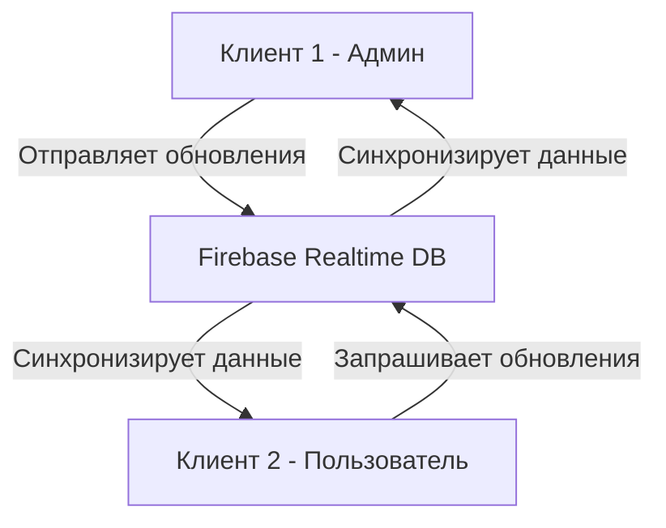
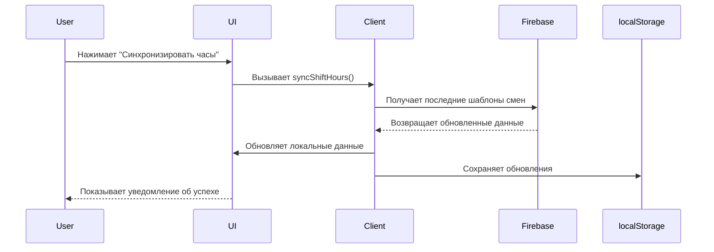

# Архитектура решения для онлайн-синхронизации часов дневников

## Текущая структура

Анализ текущей системы показывает:
- Смены хранятся в `Map<string, Shift>` где ключ - дата в формате "YYYY-MM-DD"
- Каждая смена имеет тип (`ShiftType`), часы (`hours`), минуты (`minutes`), заметки и уведомления
- Данные сохраняются локально через `localStorage` с использованием `lib/storage.ts`

## Требования

1. **Редактирование часов дневников**: Администратор может изменять рабочие часы для смен
2. **Синхронизация между пользователями**: Другие пользователи могут получить обновленные часы
3. **Кнопка синхронизации**: Интерфейс для получения последних обновлений

## Предлагаемая архитектура

### 1. Серверная часть (Firebase Realtime Database)



### 2. Структура данных в Firebase

```json
{
  "shift_templates": {
    "day": { "hours": 12, "minutes": 0 },
    "night": { "hours": 4, "minutes": 0 },
    "night2": { "hours": 12, "minutes": 0 },
    "offn": { "hours": 8, "minutes": 0 },
    "weekday": { "hours": 8, "minutes": 0 },
    "weekday15": { "hours": 8, "minutes": 15 },
    "weekday7": { "hours": 7, "minutes": 0 }
  },
  "last_updated": "2025-12-30T14:00:00Z",
  "version": "1.0.0"
}
```

### 3. Клиентская интеграция



### 4. Компоненты для реализации

1. **FirebaseService** - Сервис для работы с Firebase
2. **ShiftSyncButton** - Компонент кнопки синхронизации
3. **ShiftTemplateManager** - Менеджер шаблонов смен
4. **AdminShiftEditor** - Расширенный редактор смен для администратора

### 5. Поток данных

1. Администратор редактирует часы смен через специальный интерфейс
2. Изменения отправляются в Firebase
3. Другие пользователи нажимают кнопку "Синхронизировать часы дневников"
4. Приложение получает последние шаблоны из Firebase
5. Локальные смены обновляются согласно новым шаблонам

### 6. Безопасность

- Использовать Firebase Authentication для различения ролей (админ/пользователь)
- Правила безопасности Firebase для ограничения доступа к записям

## Реализация

Для начала нужно:
1. Создать проект Firebase
2. Настроить Realtime Database
3. Добавить Firebase SDK в проект
4. Реализовать сервис синхронизации
5. Добавить UI элементы для управления синхронизацией