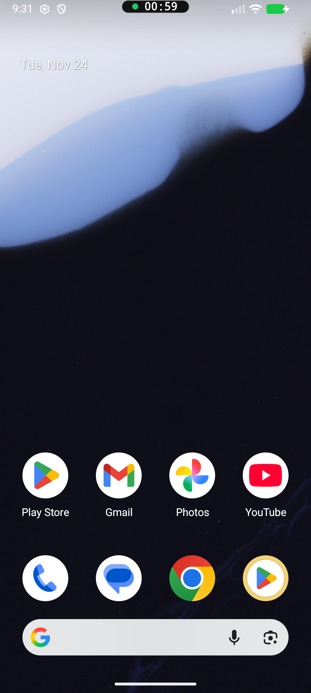
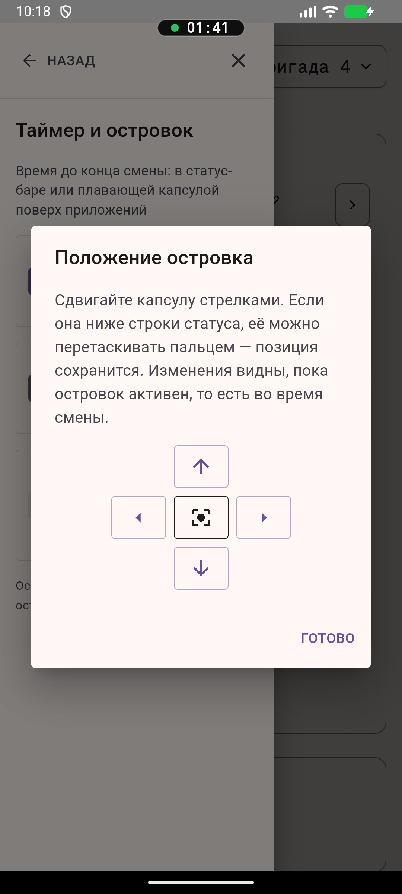
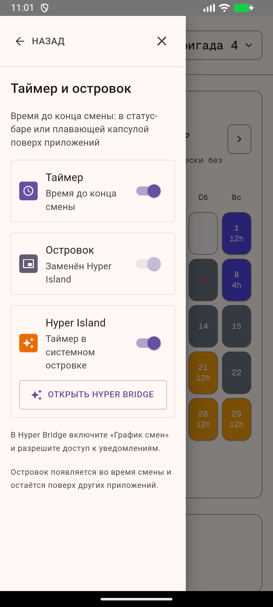
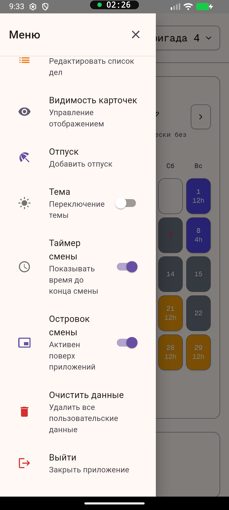
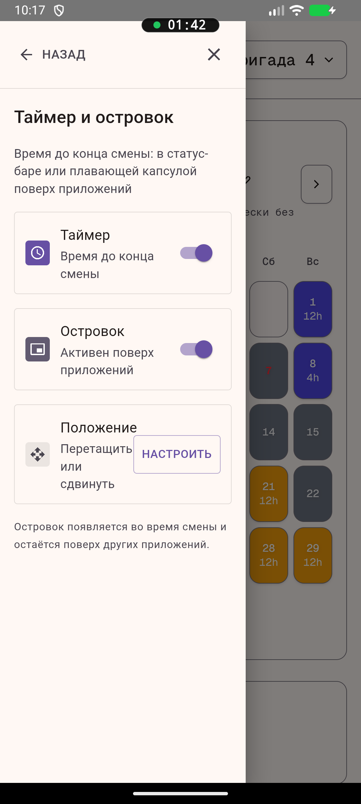

# Live-островок смены (Android)

Аналог Dynamic Island: компактная капсула в верхней части экрана, в зоне выреза
камеры, показывает время до конца смены поверх любых приложений. Положение
капсулы можно менять перетаскиванием или стрелками в меню; оно сохраняется.



Проверено на эмуляторе (Pixel, API 37): капсула остаётся на экране после
сворачивания приложения и продолжает тикать.

## Как это работает

Слои, снизу вверх:

1. **`lib/shift-timing.ts`** — единый расчёт окна смены (начало, конец,
   остаток). Раньше эта логика была продублирована в `app/page.tsx` и
   `hooks/use-shift-timer.ts`, теперь её используют оба места и островок.
2. **`hooks/use-live-shift-indicator.ts`** — решает, где показывать таймер:
   - островок, если Android + выдано разрешение «Поверх других приложений»;
   - foreground-уведомление в статус-баре (прежнее поведение) как fallback;
   - ничего, если таймер выключен.
3. **`plugins/live-island/index.ts`** — Capacitor-мост: типы, статус,
   запрос разрешения, `show/update/hide`, web-заглушка
   (`plugins/live-island/live-island-web.ts`).
4. **`LiveIslandPlugin.java`** — проверяет разрешение, запускает сервис,
   отдаёт статус (`supported`, `permission`, `running`).
5. **`LiveIslandService.java`** — foreground-сервис: окно
   `TYPE_APPLICATION_OVERLAY`, собственный тикер по `endsAt` и системное
   уведомление с обратным хронометром.

### Почему `endsAt`, а не готовые минуты

WebView-таймеры замораживаются, когда приложение уходит в фон, поэтому
JS не может обновлять надпись «каждую минуту». Вместо этого JS передаёт
момент окончания смены (`endsAt`, epoch ms), а нативный сервис сам считает
остаток раз в секунду. Так таймер продолжает идти, пока пользователь
в другом приложении, и островок скрывается сам, когда смена закончилась.

Если `endsAt` не передан, сервис использует готовую строку `remaining`
(например, для отладки).

## Файлы

| Файл | Назначение |
| --- | --- |
| `lib/shift-timing.ts` | Расчёт смены и форматирование остатка |
| `hooks/use-live-shift-indicator.ts` | Выбор режима и синхронизация |
| `plugins/live-island/index.ts` | JS-интерфейс плагина |
| `plugins/live-island/live-island-web.ts` | Заглушка для браузера |
| `android/.../LiveIslandPlugin.java` | Мост Capacitor ↔ сервис |
| `android/.../LiveIslandService.java` | Окно поверх приложений |
| `android/.../res/layout/live_island.xml` | Разметка капсулы |
| `android/.../res/drawable/live_island_background.xml` | Фон капсулы |
| `android/.../res/drawable/live_island_dot.xml` | Зелёная точка «смена идёт» |
| `plugins/hyper-island/index.ts` | JS-интерфейс режима Hyper Island |
| `android/.../HyperIslandPlugin.java` | Проверка Hyper Bridge и запуск таймера |
| `android/.../HyperIslandService.java` | Уведомление-таймер для Hyper Island |

## Разрешения

- **`SYSTEM_ALERT_WINDOW`** — «Поверх других приложений». Выдаётся только
  вручную: в приложении бургер-меню → **«Таймер и островок»** →
  «Разрешить показ поверх приложений» → системный экран разрешений.
  Секция появляется только на Android.
- **`FOREGROUND_SERVICE` + `FOREGROUND_SERVICE_SPECIAL_USE`** — объявлены в
  манифесте; тип `specialUse` обязателен для targetSdk 34.
- **`POST_NOTIFICATIONS`** — служебное уведомление foreground-сервиса
  (на Android 13+ система может его скрыть, если пользователь запретил
  уведомления; на работу островка это не влияет).

## Положение островка

Капсулу можно двигать двумя способами:

- **Перетаскиванием.** Нажмите на капсулу и потяните — позиция сохранится.
  Работает, когда капсула ниже строки статуса: касания в зоне статус-бара
  перехватывает SystemUI.
- **Кнопками.** Бургер-меню → **«Таймер и островок»** → **«Положение»** →
  «Настроить» → стрелки (шаг 10 dp); центральная кнопка возвращает капсулу
  по центру верхней кромки.

Позиция хранится в `SharedPreferences` (`live_island_position`) и
восстанавливается при следующем запуске сервиса. Сброс удаляет сохранённую
позицию.



## Hyper Island (Xiaomi HyperOS)

Системный островок HyperOS нельзя включить из стороннего приложения напрямую.
Приложение поддерживает связку с **Hyper Bridge** — это отдельное приложение,
которое читает обычные Android-уведомления и рисует их в Hyper Island.

Как включить:

1. Установить [Hyper Bridge](https://play.google.com/store/apps/details?id=com.d4viddf.hyperbridge).
2. В Hyper Bridge выдать доступ к уведомлениям и включить «График смен» в списке приложений.
3. В приложении: бургер-меню → **«Таймер и островок»** → **Hyper Island** → включить.
4. Во время смены в системном островке появится обратный отсчёт.

Наш плавающий островок и Hyper Island взаимоисключающие: при включении Hyper
Island окно не показывается. Уведомление, которое видит Hyper Bridge, содержит
`setUsesChronometer(true)`, `setWhen(конец смены)` и категорию `STOPWATCH` —
именно такие уведомления Hyper Bridge распознаёт как таймер и показывает
с обратным отсчётом.

Ограничения:

- Hyper Bridge работает только на Xiaomi/Redmi/POCO с HyperOS. На других
  устройствах карточка Hyper Island остаётся с кнопкой установки, но системного
  островка не будет.
- Hyper Bridge пропускает уведомления в режиме «Не беспокоить».
- Приложение должно быть разрешено в Hyper Bridge; после установки Hyper Bridge
  включите «График смен» в его списке приложений.
- Если Hyper Bridge не установлен, режим включать бессмысленно — останется
  обычное уведомление с таймером.



## Как собрать и проверить

```powershell
npm run build
npx cap sync android
cd android
.\gradlew assembleDebug
```

Или готовый скрипт: `.\build-android.ps1`.

Проверка на устройстве:

1. Установить APK, открыть приложение.
2. Бургер-меню → **«Таймер и островок»** → включить таймер и островок,
   при необходимости выдать разрешение «Поверх других приложений».
3. Дождаться начала смены (или временно поменять тип смены на сегодня).
4. Свернуть приложение → капсула остаётся вверху и тикает.
5. Перетащить капсулу или сдвинуть её стрелками в меню, перезапустить
   приложение → позиция сохраняется.
6. Тап по капсуле открывает приложение (если она ниже строки статуса).
7. Выключить таймер или островок в меню → капсула исчезает.
8. Hyper Island: установить Hyper Bridge, разрешить «График смен» в его
   настройках, включить **Hyper Island** в секции. Системный островок покажет
   обратный отсчёт, а наш плавающий островок отключится.

В главном меню таймер и островок объединены в один пункт:



Он открывает секцию с переключателями и настройкой положения:



## Грабли, на которые уже наступили

- **Порядок регистрации плагинов.** В Capacitor 5 `BridgeActivity.onCreate`
  создаёт мост в конце своего `onCreate`, поэтому `registerPlugin(...)` нужно
  вызывать **до** `super.onCreate(savedInstanceState)`. Иначе плагин попадает
  в билдер уже после создания моста, и JS получает
  `unable to find plugin : LiveIsland`. Это же ломало и старый
  `ForegroundServicePlugin` — теперь оба регистрируются правильно.
- **Тип foreground-сервиса.** Для targetSdk 34 в манифесте обязателен
  `android:foregroundServiceType="specialUse"` + разрешение
  `FOREGROUND_SERVICE_SPECIAL_USE`, иначе `startForeground` падает на Android 14+.
- **Фон.** Нельзя полагаться на JS-интервал: WebView замораживает таймеры.
  Поэтому сервис считает остаток сам по `endsAt`.
- **Видимость пакета.** Android 11+ не видит установленный Hyper Bridge без
  `<queries><package android:name="com.d4viddf.hyperbridge" /></queries>` в
  манифесте. Без этого блока кнопка всегда показывала бы «Установить».

## Ограничения

- **Статус-бар.** Окно рисуется выше приложений, но ниже иконок SystemUI.
  Поэтому капсула в зоне статус-бара может перекрываться часами/иконками,
  а касания там перехватывает SystemUI. Для перетаскивания и тапа сдвиньте
  капсулу ниже статус-бара (стрелками в меню).
- **Вырез камеры.** Камера физически перекрывает центр капсулы — именно это
  и даёт эффект «островка». На устройствах без выреза капсула выглядит как
  чёрная пилюля у верхней кромки.
- **Экран блокировки.** Overlay-окна, как правило, не показываются на
  lock screen.
- **Смена через полночь.** Текущая смена берётся по календарной дате, как и
  в остальном приложении: после 00:00 ночная смена предыдущего дня может
  перестать отображаться. Это существующее поведение расписания, а не
  особенность островка.
- **Начало смены в фоне.** Островок запускается из приложения, поэтому если
  свернуть его до начала смены, капсула появится только после возврата в
  приложение. Уже запущенный островок продолжает жить в фоне и скрывается
  сам в конце смены.
- **Android 16 Live Updates.** Системный путь для «живых» уведомлений пока
  не используется — островок остаётся overlay-окном.

## Дальнейшие шаги

- Перейти на `Notification.ProgressStyle` + promoted ongoing для Android 16+.
- Добавить прогресс-полосу смены внутри капсулы.
- Сворачивание/разворачивание капсулы по тапу, быстрые действия.
- Привязка позиции к краям/сетке и отдельные пресеты для ландшафта.
- Автозапуск сервиса после перезагрузки (`BOOT_COMPLETED`).
