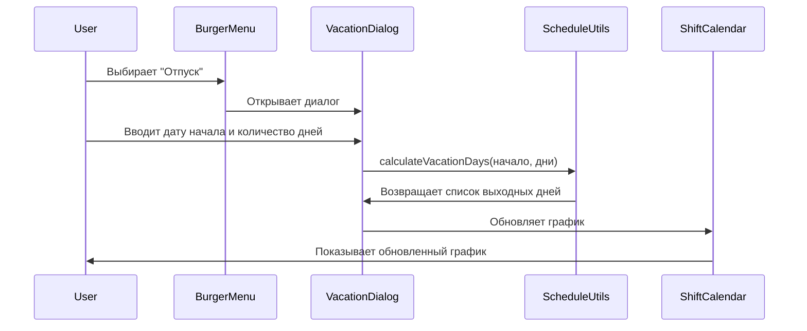

# План добавления функционала "Отпуск" в burger-menu

## Обзор
Добавить новый пункт в burger-menu, который позволит пользователю вводить дату начала отпуска и количество дней. Система должна автоматически проставлять выходные дни на указанное количество дней, учитывая праздничные дни и продлевая отпуск на количество праздничных дней, попавших в этот период.

## Анализ текущей структуры
1. **Burger-menu**: В настоящее время меню содержит несколько разделов, таких как "Тип графика", "Цвета смен", "Оклад", "Список дел", "Видимость карточек", "Тема", "Очистить данные" и "Выйти".
2. **Логика обработки праздников**: В файле `lib/holidays.ts` определены функции для генерации праздничных дней, включая статические и динамические праздники. В файле `lib/types.ts` определены типы данных, включая `Holiday` и `Shift`.

## План реализации

### 1. Создание интерфейса для ввода данных об отпуске
- **Компонент**: Создать новый компонент `VacationDialog` для ввода даты начала и количества дней отпуска.
- **Поля**:
  - Дата начала отпуска (используя `DatePicker` или аналогичный компонент).
  - Количество дней отпуска (числовое поле).
- **Валидация**: Убедиться, что дата начала и количество дней корректны.

### 2. Реализация логики расчета отпуска
- **Функция**: Создать функцию `calculateVacationDays` в `lib/schedule-utils.ts`, которая будет:
  - Принимать дату начала и количество дней отпуска.
  - Генерировать список дней отпуска, исключая выходные и праздничные дни.
  - Продлевать отпуск на количество праздничных дней, попавших в этот период.
  - Возвращать список дат, которые должны быть отмечены как выходные.

### 3. Интеграция с burger-menu
- **Новый пункт меню**: Добавить новый пункт "Отпуск" в `components/burger-menu.tsx`.
- **Обработчик**: Добавить обработчик для открытия диалогового окна ввода данных об отпуске.
- **Сохранение изменений**: Обновить график работы, добавив выходные дни на период отпуска.

### 4. Тестирование
- **Тесты**: Написать тесты для функции `calculateVacationDays`, чтобы убедиться, что она корректно обрабатывает праздничные дни и продлевает отпуск.
- **Интеграционные тесты**: Убедиться, что новый функционал корректно интегрирован в burger-menu и работает в рамках всего приложения.

## Диаграмма последовательности

## Ожидаемый результат
После реализации пользователь сможет:
1. Выбрать пункт "Отпуск" в burger-menu.
2. Ввести дату начала и количество дней отпуска.
3. Система автоматически проставит выходные дни на указанное количество дней, исключая праздничные дни и продлевая отпуск на их количество.
4. Обновленный график будет отображен в календаре.